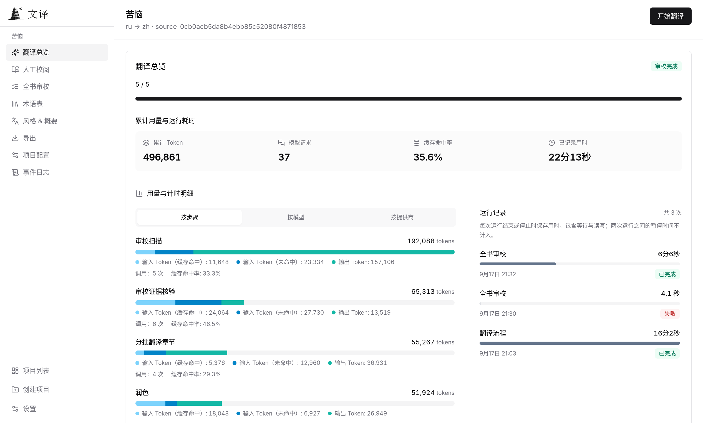

<div align="center">

<h1>
  
  <br>
  
</h1>

**Carry stories across languages.**

A desktop app for translating books and long-form writing, with the whole work in view.

Whole-book understanding · Consistent terminology · Evidence-based review

[](https://github.com/BigDawnGhost/wenyi/actions/workflows/tests.yml)
[](LICENSE)
[](https://github.com/BigDawnGhost/wenyi/stargazers)
[](https://discord.gg/sM3AQcF5D2)

[Quick start](#quick-start) · [Supported formats](#supported-formats) · [Interface preview](#interface-preview) · [Documentation](#documentation)

**English** | [简体中文](docs/zh/README.md)

<a href="https://hellogithub.com/repository/BigDawnGhost/wenyi" target="_blank"></a>

</div>

---

## Sponsors

Thank you to PackyCode for sponsoring Wenyi.

<table>
  <tr>
    <td align="center" width="200">
      <a href="https://www.packyapi.ai/register?aff=KIzj">
        
      </a>
    </td>
    <td>
      <a href="https://www.packyapi.ai/register?aff=KIzj">
        PackyCode provides access to leading AI models through one API endpoint and one API key, with automatic failover and dedicated routes for Codex and Claude Code.
      </a>
    </td>
  </tr>
</table>

---

## Why Wenyi

Wenyi is designed for **long-form texts** — novels, social-science monographs, narrative nonfiction, and more.

- **Whole-book context** — chapter digests, a book-level synopsis, and rolling context help each batch stay connected to the rest of the work.
- **Consistent terminology** — names, terms, and recurring expressions are extracted during translation; conflicting translations are surfaced for resolution and feed back into subsequent batches.
- **Translation and review** — optional polishing and evidence-driven whole-book review complement paragraph editing with revision history.
- **Resumable progress** — completed batches and chapters are saved; reopen the project and continue from its checkpoints.
- **Flexible models** — use DeepSeek, OpenAI, OpenRouter, OrcaRouter, Google Gemini, Ollama, vLLM, or other OpenAI-compatible services. Choose models per operation and share request limits through [model routing](docs/configuration.md#models-and-operation-routing).

---

## Supported formats

| Input | Output |
|---|---|
| EPUB, PDF, DOCX, FB2, TXT, Markdown, HTML | EPUB, PDF (BabelDOC projects), DOCX, TXT, HTML, Markdown |

- **EPUB** — translated text is written back into the original XHTML templates, preserving styles, images, table of contents, and anchors where possible. Vertical layout is converted to horizontal for Chinese reading.
- **PDF** — MinerU is the default input backend; the initial conversion requires its API key, and the resulting HTML is cached. For PDFs with a text layer, the optional BabelDOC bridge can preserve layout through translation and PDF export. **PDF output is available only for saved BabelDOC projects**; MinerU projects export to the other formats above. See [PDF setup](docs/cli.md#pdf-support).
- **DOCX** — headings, simple tables, lists, and common character/paragraph styles are preserved where possible; translated Chinese uses Song (宋体).
- **Bilingual editions** — export source-and-translation editions where supported; EPUB and HTML offer subdued source text with dark-mode support.

---

## Quick start

### Desktop (recommended)

1. Download the `wenyi-desktop-*` package for your system from [GitHub Releases](https://github.com/BigDawnGhost/wenyi/releases).
2. Open **Settings → Models & connections**, choose a provider, enter your API key if required, and save.
3. Create a project, import a book, and start translating. Proofread in the app, then choose an export format and save destination.

The installer includes the translation engine and Python runtime. Projects stay in a local workspace; translation uses your configured model service. See the [Desktop guide](docs/desktop.md#quick-start) for platform requirements and setup.

### CLI (PyPI)

No repository checkout is needed. With Python 3.10+ and [uv](https://docs.astral.sh/uv/), install [wenyi-cli](https://pypi.org/project/wenyi-cli/) and preview the default model configuration:

```bash
uv tool install wenyi-cli
wenyi models list
```

The first `models list` creates `config.yaml` in the current directory if it is missing, without calling a model. Review it before translating. For the default DeepSeek provider, set your own key in your local terminal:

```bash
export DEEPSEEK_API_KEY="YOUR_DEEPSEEK_API_KEY"
wenyi translate book.epub
```

For Windows commands, other providers, upgrades, and resume/export options, see the [CLI guide](docs/cli.md).

### Web and development

For a self-hosted browser workspace, see [Web deployment](docs/web.md). To run or modify the source, see [Contributing](CONTRIBUTING.md#run-the-cli-from-source).

---

## Interface preview

Desktop and Web share the proofreading workspace: live progress, paragraph editing with revision history, and whole-book review results. The screenshot below shows the Web Chinese interface; English is available in Settings.

<p align="center">
  
  <br>
  <sub>Translation overview: usage by step, cache hit rates, and run durations.</sub>
</p>

**Translation examples:** browse public-domain translations in [wenyi-bookcase](https://github.com/BigDawnGhost/wenyi-bookcase), or contribute your own. Do not share copyrighted text, private books, or sensitive workspace data without permission.

---

## Limitations

- **Translation quality** — Results are bounded by the capabilities of the chosen LLM model.
- **Token usage** — Polishing and whole-book review can significantly increase token usage. Shadow fixing may trigger multiple full-book review passes and additional Fixer calls.
- **Storage** — Workspace size grows with book length; very long books may require substantial disk space.

---

## Documentation

| Guide | Contents |
|---|---|
| [Desktop](docs/desktop.md) | Downloads, model setup, proofreading, exports, and local data |
| [CLI](docs/cli.md) | PyPI installation, commands, resume, and export |
| [Web deployment](docs/web.md) | Self-hosted browser workspace with independent project data |
| [Configuration](docs/configuration.md) | Providers, model routing, pipeline options, and paths |
| [Translation pipeline](docs/pipeline.md) | Whole-book analysis, terminology, context, polishing, and review |
| [Architecture](docs/architecture.md) | Module responsibilities, shared services, and platform boundaries |
| [Contributing](CONTRIBUTING.md) | Source setup, development, testing, and contributions |

---

## Community

Wenyi is a personal project created to help bring books and long-form writing across languages. Bug reports, ideas, and pull requests are welcome.

- [Discord server](https://discord.gg/sM3AQcF5D2)
- QQ group: 1055065098
- [GitHub Issues](https://github.com/BigDawnGhost/wenyi/issues) — bug reports and feature requests
- [GitHub Discussions](https://github.com/BigDawnGhost/wenyi/discussions) — ideas and questions

---

## Star history

<a href="https://star-history.dera.page/#BigDawnGhost/wenyi&type=date&legend=top-left">
 <picture>
   <source media="(prefers-color-scheme: dark)" srcset="https://star-history.dera.page/svg?repos=BigDawnGhost/wenyi&type=date&theme=dark&legend=top-left" />
   <source media="(prefers-color-scheme: light)" srcset="https://star-history.dera.page/svg?repos=BigDawnGhost/wenyi&type=date&legend=top-left" />
   
 </picture>
</a>

---

## License

[MIT](LICENSE)

---

## AtomGit (China)

Wenyi is also hosted on AtomGit: [https://atomgit.com/BigDawnGhost/wenyi](https://atomgit.com/BigDawnGhost/wenyi)
