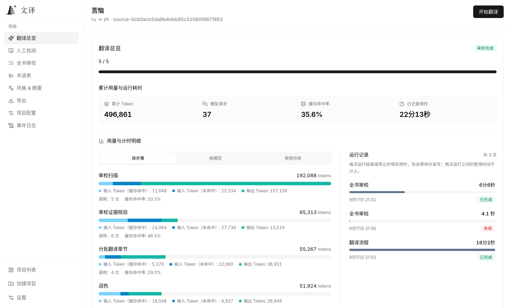

<div align="center">

<h1>
  
  <br>
  
</h1>

**将被语言阻隔的作品，带到读者的语言中。**

面向书籍与长篇文字的桌面翻译应用，在全书语境中完成翻译。

全书理解 · 术语一致 · 取证式审校

[](../../LICENSE)
[](https://github.com/BigDawnGhost/wenyi/stargazers)
[](https://discord.gg/sM3AQcF5D2)

[快速开始](#快速开始) · [支持格式](#支持格式) · [界面预览](#界面预览) · [使用文档](#文档)

[English](../../README.md) | **简体中文**

<a href="https://hellogithub.com/repository/BigDawnGhost/wenyi" target="_blank"></a>

</div>

---

## 为什么选择文译

文译为**长文本**设计 —— 长篇小说、社科专著、纪实文学……

- **全书上下文** — 逐章梗概、全书概览与滚动上下文，让每批翻译与全书保持联系。
- **术语一致** — 翻译中提取人名、术语和固定表达，发现译法冲突后提示裁决，并将结果用于后续批次。
- **翻译与审校** — 可选润色和取证式全书审校，结合带版本记录的段落编辑完成校阅。
- **断点续跑** — 自动保存已完成批次和章节进度，重新打开项目即可从检查点继续。
- **灵活选模型** — 支持 DeepSeek、OpenAI、OpenRouter、OrcaRouter、Google Gemini、Ollama、vLLM 及其他 OpenAI 兼容服务，可通过[模型路由](reference/configuration.md)按操作选择模型、共享请求限额。

---

## 支持格式

| 输入 | 输出 |
|---|---|
| EPUB、PDF、DOCX、FB2、TXT、Markdown、HTML | EPUB、PDF（BabelDOC 项目）、DOCX、TXT、HTML、Markdown |

- **EPUB** — 将译文回填到原书 XHTML 模板，尽量保留样式、图片、目录和锚点；竖排转为横排以适配中文阅读。
- **PDF** — 默认使用 MinerU 解析，首次转换需要其 API Key，生成的 HTML 会缓存复用。带文本层的 PDF 可选择 BabelDOC bridge，在翻译与 PDF 导出时尽量保留版式。**PDF 导出仅适用于已保存的 BabelDOC 项目**；MinerU 项目可导出为上表中的其他格式。详见 [PDF 支持](reference/formats.md#pdf)。
- **DOCX** — 尽量保留标题、简易表格、列表和常见字符／段落样式；已译中文使用宋体。
- **双语对照** — 在支持的格式中导出原文与译文对照版；EPUB、HTML 支持原文淡化显示和深色阅读。

---

## 快速开始

### Desktop（推荐）

1. 在 [GitHub Releases](https://github.com/BigDawnGhost/wenyi/releases) 下载适合系统的 `wenyi-desktop-*` 安装包。
2. 打开**设置 → 模型与接口**，选择提供商，按需填写 API Key 并保存。
3. 创建项目、导入书籍并开始翻译；在应用内校阅后，选择导出格式和保存位置。

安装包内置翻译引擎和 Python 运行环境。项目保存在本地工作区，翻译使用你配置的模型服务。平台要求和设置步骤见 [Desktop 使用指南](guide/desktop.md)。

### CLI（PyPI）

无需拉取源码。安装 Python 3.10+ 和 [uv](https://docs.astral.sh/uv/) 后，从 PyPI 安装 [wenyi-cli](https://pypi.org/project/wenyi-cli/)，并查看默认模型配置：

```bash
uv tool install wenyi-cli
wenyi models list
```

首次执行 `models list` 时，若当前目录没有 `config.yaml`，会自动创建，不调用模型。请先检查配置，再开始翻译。默认使用 DeepSeek，在本机终端中设置自己的密钥：

```bash
export DEEPSEEK_API_KEY="YOUR_DEEPSEEK_API_KEY"
wenyi translate book.epub
```

Windows 命令、其他提供商、升级及续跑／导出选项见 [CLI 使用指南](guide/cli.md)。

### Web

需要自部署浏览器工作台时，参见 [Web 部署](guide/web.md)。

---

## 界面预览

Desktop 与 Web 共用校阅工作台，可查看实时进度、编辑段落并追踪版本，以及查看全书审校结果。下图展示 Web 中文界面，也可在设置中切换为英文。

<p align="center">
  
  <br>
  <sub>翻译总览：查看步骤用量、缓存命中率和运行耗时。</sub>
</p>

**翻译示例：** 可在 [wenyi-bookcase](https://github.com/BigDawnGhost/wenyi-bookcase) 查看公版书译作，也欢迎提交分享。请勿分享无授权的版权文本、私人书籍或包含敏感信息的工作区数据。

---

## 当前限制

- **翻译质量** — 译文质量受所选大模型的能力限制。
- **Token 消耗** — 润色和全书审校可能显著增加 token 消耗；开启影子修订后，还可能执行多次全书审校和额外 Fixer 调用。
- **存储空间** — 工作区大小随书籍长度增长，极长书籍可能占用较多磁盘空间。

---

## 文档

**文档站**：[bigdawnghost.github.io/wenyi/zh](https://bigdawnghost.github.io/wenyi/zh/)

站点侧栏按用户指南、参考资料和开发维护分类，中英文通过站点语言菜单切换。
贡献与审查要求见[贡献指南](CONTRIBUTING.md)。

---

## 社区

文译是一个个人兴趣项目，希望帮助更多书籍与长篇文字跨越语言。欢迎反馈问题、交流想法或提交 PR，一起改进文译。

- [Discord 服务器](https://discord.gg/sM3AQcF5D2)
- QQ 群：1055065098
- [GitHub Issues](https://github.com/BigDawnGhost/wenyi/issues) — 问题反馈与功能建议
- [GitHub Discussions](https://github.com/BigDawnGhost/wenyi/discussions) — 想法与讨论

---

## 星标历史

<a href="https://star-history.dera.page/#BigDawnGhost/wenyi&type=date&legend=top-left">
 <picture>
   <source media="(prefers-color-scheme: dark)" srcset="https://star-history.dera.page/svg?repos=BigDawnGhost/wenyi&type=date&theme=dark&legend=top-left" />
   <source media="(prefers-color-scheme: light)" srcset="https://star-history.dera.page/svg?repos=BigDawnGhost/wenyi&type=date&legend=top-left" />
   
 </picture>
</a>

---

## 许可证

文译采用 [GNU 通用公共许可证 v3.0（GPLv3）](../../LICENSE)。

可选的 BabelDOC bridge 是独立采用 AGPL 许可的服务，在独立进程中通过 HTTP 调用。
详见 [PDF 支持](reference/formats.md#pdf)。

---

## 国内 AtomGit 托管

本项目在 AtomGit 亦有镜像：[https://atomgit.com/BigDawnGhost/wenyi](https://atomgit.com/BigDawnGhost/wenyi)
